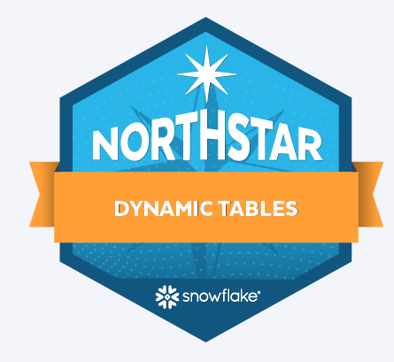

## Project Overview
**Project Title**: Creating Declarative Data Pipelines in Snowflake ❄️

**Database**: `Analytics_DB`

Declarative Data Pipeline with Snowflake Dynamic Tables

This project demonstrates how to build a Declarative Data Pipeline in Snowflake using Dynamic Tables and synthetic customer and order data. Raw data is loaded into Snowflake, where Dynamic Tables automatically transform and update the data through scheduled refreshes, creating analytics-ready datasets with minimal manual intervention.

The project highlights modern ELT practices, automated data transformations, and how Snowflake simplifies pipeline development through a scalable, SQL-driven approach.


## Objectives
1. Build a Declarative Data Pipeline using Snowflake Dynamic Tables and synthetic customer and order data.
2. Scheduled Automated Pipeline Refreshes to keep data updated without manual intervention.

## Project Structure

### 1. Setting up the database and generate synthetic data using Python UDTF.
```sql
-- Select the account you using
use role accountadmin;

-- Creating a warehouse to store our data and perfrom computations
create warehouse if not exists compute_wh
with warehouse_size = 'large'
auto_suspend = 300
auto_resume = true;

-- Creating two databases, one for raw data and once for transformed models
create database if not exists raw_db;
create database if not exists analytics_db;
use database raw_db;

-- Create a Python UDTF that can be used to generate fake customer data
create or replace function gen_cust_info(num_records number)
returns table (custid number(10), cname varchar(100), spendlimit number(10,2))
language python
runtime_version=3.10
handler='CustTab'
packages = ('Faker')
as $$
from faker import Faker
import random

fake = Faker()
# Generate a list of customers  

class CustTab:
    # Generate multiple customer records
    def process(self, num_records):
        customer_id = 1000 # Starting customer ID                 
        for _ in range(num_records):
            custid = customer_id + 1
            cname = fake.name()
            spendlimit = round(random.uniform(1000, 10000),2)
            customer_id += 1
            yield (custid,cname,spendlimit)

$$;

-- Create a Python UDTF that can be used to generate an fake inventory of products
create or replace function gen_prod_inv(num_records number)
returns table (pid number(10), pname varchar(100), stock number(10,2), stockdate date)
language python
runtime_version=3.10
handler='ProdTab'
packages = ('Faker')
as $$
from faker import Faker
import random
from datetime import datetime, timedelta
fake = Faker()

class ProdTab:
    # Generate multiple product records
    def process(self, num_records):
        product_id = 100 # Starting product ID                 
        for _ in range(num_records):
            pid = product_id + 1
            pname = fake.catch_phrase()
            stock = round(random.uniform(500, 1000),0)
            # Get the current date
            current_date = datetime.now()
            
            # Calculate the maximum date (3 months from now)
            min_date = current_date - timedelta(days=90)
            
            # Generate a random date within the date range
            stockdate = fake.date_between_dates(min_date,current_date)

            product_id += 1
            yield (pid,pname,stock,stockdate)

$$;

-- Create a Python UDTF that can be used to generate fake customer order data
create or replace function gen_cust_purchase(num_records number,ndays number)
returns table (custid number(10), purchase variant)
language python
runtime_version=3.10
handler='genCustPurchase'
packages = ('Faker')
as $$
from faker import Faker
import random
from datetime import datetime, timedelta

fake = Faker()

class genCustPurchase:
    # Generate multiple customer purchase records
    def process(self, num_records,ndays):       
        for _ in range(num_records):
            c_id = fake.random_int(min=1001, max=1999)
            
            #print(c_id)
            customer_purchase = {
                'custid': c_id,
                'purchased': []
            }
            # Get the current date
            current_date = datetime.now()
            
            # Calculate the maximum date (days from now)
            min_date = current_date - timedelta(days=ndays)
            
            # Generate a random date within the date range
            pdate = fake.date_between_dates(min_date,current_date)
            
            purchase = {
                'prodid': fake.random_int(min=101, max=199),
                'quantity': fake.random_int(min=1, max=5),
                'purchase_amount': round(random.uniform(10, 1000),2),
                'purchase_date': pdate
            }
            customer_purchase['purchased'].append(purchase)
            
            #customer_purchases.append(customer_purchase)
            yield (c_id,purchase)

$$;

-- Create the customers table using the UDTF for fake customer data
create or replace table customers as select * from table(gen_cust_info(1000)) order by 1;
-- Create the products table using the UDTF for fake product data
create or replace table products as select * from table(gen_prod_inv(100)) order by 1;
-- Create an orders table using the UDTF for fake customer order data 
create or replace table orders as select * from table(gen_cust_purchase(10000,10));

-- Preview customer information table, each customer has spending limits
select * from customers limit 10;
-- Preview product table, each product has stock level from fulfilment day
select * from products limit 10;
-- Preview sale orders for products purchsaed online by various customers
select * from orders limit 10;
```
### 2. Creating the orders and customers dynamic tables
```sql
--Exploring the Customers Table
use role accountadmin;
use warehouse compute_wh;
use database analytics_db;
desc table raw_db.public.customers;
select * from raw_db.public.customers;

--Create the Customers Dynamic Table
create or replace dynamic table stg_customers_dt
    target_lag=downstream
    warehouse=compute_wh
    as select
        custid as customer_id,
        cname as customer_name,
        cast(spendlimit as float) as spend_limit
    from raw_db.public.customers;

--Explore the Orders Table
desc table raw_db.public.orders;
select * from raw_db.public.orders;

--Create the Orders Dynamic Table
create or replace dynamic table stg_orders_dt
   target_lag=downstream
   warehouse=compute_wh
   as select
       custid as customer_id,
       purchase:"prodid"::number(5) as product_id,
       purchase:"purchase_amount"::float(10) as order_price,
       purchase:"quantity"::number(5) as quantity,
       purchase:"purchase_date"::date as order_date
   from raw_db.public.orders;

-- Verify the Dynamic Tables
select * from analytics_db.public.stg_customers_dt;
select * from analytics_db.public.stg_orders_dt;

--View all Dynamic Tables and check the TARGET_LAG
show dynamic tables;
```
### 3. Setting up the SQL file and chaining the orders and customer dynamic table.
```sql
--Set Up Your SQL File
use role accountadmin;
use warehouse compute_wh;
use database analytics_db;
select * from analytics_db.public.stg_customers_dt;
select * from analytics_db.public.stg_orders_dt;

--Create the Fact Dynamic Table
create or replace dynamic table fct_customer_orders_dt
    target_lag=downstream
    warehouse=compute_wh
    as select
        c.customer_id,
        c.customer_name,
        o.product_id,
        o.order_price,
        o.quantity,
        o.order_date
    from stg_customers_dt c
    left join stg_orders_dt o
        on c.customer_id = o.customer_id;

select * from analytics_db.public.fct_customer_orders_dt;
```
### 4. Setting auto refresh(orchastration) of the pipeline
```sql
use role accountadmin;
use warehouse compute_wh;
use database analytics_db;
show dynamic tables;

--Adjust Refresh Frequency
alter dynamic table stg_orders_dt set target_lag = '5 minutes';
```
### 5. Implementing Data quality checker and cleaning of null data.
```sql
--Implement Data Quality
select * from analytics_db.public.fct_customer_orders_dt;


--Add a data quality filter to remove null orders:
create or replace dynamic table fct_customer_orders_dt
    target_lag=downstream
    warehouse=compute_wh
    as select
        c.customer_id,
        c.customer_name,
        o.product_id,
        o.order_price,
        o.quantity,
        o.order_date
    from stg_customers_dt c
    left join stg_orders_dt o
        on c.customer_id = o.customer_id
    where o.product_id is not null;

select * from analytics_db.public.fct_customer_orders_dt;
```
Credits to Snowflake Training
Badge

[**badge link**](https://developerbadges.snowflake.com/57c976da-a564-4339-9f9e-b98f60bfd8bb#acc.FPMC4KiA)
